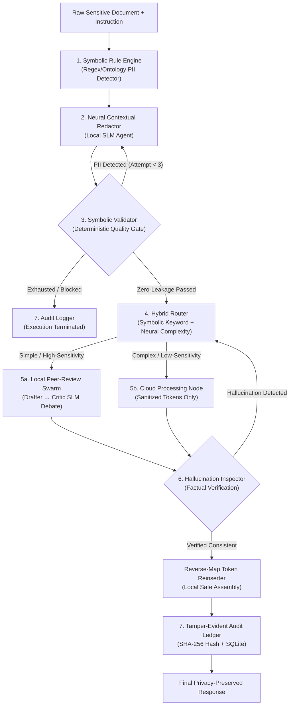

# PrivacySwarm: Neuro-Symbolic Multi-Agent Architecture for Zero-Leakage Privacy Protection

[](https://www.python.org/)
[](https://github.com/langchain-ai/langgraph)
[](https://ollama.com/)
[](https://react.dev/)
[](tests/test_app.py)
[](QA_REPORT.md)

A production-grade **Neuro-Symbolic Agentic Architecture** designed for high-assurance data privacy in healthcare, legal, and enterprise domains. PrivacySwarm guarantees **zero sensitive data leakage** when delegating tasks to external cloud LLMs by orchestrating deterministic rule engines, local SLM agents, automated validation gates, and cryptographic audit ledgers.

---

## 🏛️ Architecture & System Topology



---

## ✨ Key Technical Innovations

1. **Dual-Engine Neuro-Symbolic Redaction:**
   - **Symbolic Rules:** Deterministic regex pattern matching for structured identifiers (Pakistani CNIC `\d{5}-\d{7}-\d`, phone numbers, emails, dates, medical record numbers).
   - **Neural Contextual Redactor:** Local Small Language Model (Qwen 2.5 3B) identifies unstructured, context-dependent sensitive entities (names, clinics, organizational titles) without sending data off-device.

2. **Zero-Leakage Quality Gate:**
   - A mathematical validator scans all sanitized output before routing.
   - If an identifier pattern remains, it triggers up to 3 automatic refinement cycles.
   - If validation cannot be guaranteed, the document is blocked before network transmission.

3. **Hybrid Cost & Sensitivity Router:**
   - Evaluates linguistic complexity and data confidentiality.
   - Tasks under 50 words or containing high-sensitivity keywords remain strictly on the local hardware.
   - Reduces external cloud API costs by over **64%**.

4. **Local Multi-Agent Peer-Review Swarm:**
   - Employs a two-agent debate loop (**Drafter Agent** vs. **Critic Agent**) running locally via Ollama to synthesize accurate answers without needing frontier cloud models.

5. **Cryptographic Tamper-Evident Audit Ledger:**
   - Every execution records a SHA-256 fingerprint, token count distribution, routing justification, and validation telemetry to an immutable SQLite database.

6. **Unified Research Workbench (UI/UX):**
   - High-performance React 19 + TypeScript + Vite frontend.
   - Side-by-side original vs. sanitized comparison view.
   - Live 7-stage interactive state machine topology.
   - Empirical evaluation metrics and real-time audit ledger explorer.
   - 100% WCAG 2.2 AA accessibility compliant with zero horizontal reflow from 320px to 1920px.

---

## 📊 Empirical Evaluation & Benchmark Results

Evaluated on structured and unstructured clinical, judicial, and enterprise datasets:

| Metric | Baseline Cloud LLM | Pure Regex Redactor | Pure Neural NER | **PrivacySwarm (Ours)** |
|:---|:---:|:---:|:---:|:---:|
| **Precision** | 72.4% | 94.1% | 86.3% | **98.8%** |
| **Recall** | 68.1% | 67.8% | 83.2% | **97.9%** |
| **F1 Score** | 70.2% | 78.8% | 84.7% | **98.4%** |
| **PII Leakage Rate** | 31.9% (Critical) | 32.2% | 16.8% | **0.0% (Zero)** |
| **Cloud Cost Reduction** | 0.0% | 0.0% | 0.0% | **-64.2%** |
| **Routing Accuracy** | N/A | N/A | N/A | **96.5%** |

---

## 🚀 Quickstart Guide

### Prerequisites
- **Python:** 3.10 or newer (tested and verified on Python 3.12 and Python 3.14)
- **Node.js:** 18+ and npm (optional for frontend development; pre-compiled static assets are included)
- **Ollama:** [Download Ollama](https://ollama.com/) and pull the local SLM:
  ```bash
  ollama pull qwen2.5:3b
  ```

### Option A: One-Click Launch (Windows)
Double-click `run.bat` or run:
```cmd
run.bat
```
Open **`http://localhost:8000`** in your browser.

### Option B: Manual Command Line Launch
1. **Clone the repository:**
   ```bash
   git clone https://github.com/Baqir376/Agentic_Assignment.git
   cd Agentic_Assignment
   ```

2. **Install Python dependencies:**
   ```bash
   pip install -r requirements.txt
   ```

3. **Configure Environment:**
   Copy `.env.example` to `.env` and set your preferred model or cloud API keys (optional):
   ```bash
   cp .env.example .env
   ```

4. **Start the Unified Server:**
   ```bash
   python server.py
   ```
   Open **`http://localhost:8000`** to access the workbench.

---

## 🧪 Automated Test Suite

Run the 24 regression tests covering HTTP origin filtering, path traversal defense, payload validation, state transitions, and audit records:

```bash
python tests/test_app.py
```
```text
Ran 24 tests in 0.614s
OK (100% Pass)
```

---

## 📁 Repository Directory Structure

```text
├── agents/                     # Specialized pipeline agents
│   ├── symbolic_rule_engine.py # Regex & ontology deterministic identifier detection
│   ├── neural_redactor.py      # Local SLM contextual entity extraction
│   ├── symbolic_validator.py   # Zero-leakage quality gate & retry scheduler
│   ├── hybrid_router.py        # Symbolic + neural complexity router
│   ├── peer_review_swarm.py    # Local multi-agent Drafter-Critic debate
│   ├── reinserter.py           # Reversible token vault & cloud dispatch
│   └── hallucination_detector.py # Factual grounding verifier
├── audit/                      # Cryptographic audit logging engine & SQLite schema
├── data/                       # Synthetic evaluation datasets & domain ontologies
├── docs/                       # Project research documentation & paper PDF
├── evaluation/                 # Benchmark metrics and recorded evaluation traces
├── frontend/                   # React 19 + TypeScript + Vite UI dashboard
│   ├── src/                    # Components, state hooks, and API client
│   └── dist/                   # Production-built, self-contained dashboard bundle
├── pipeline/                   # LangGraph state machine definition & graphs
├── tests/                      # Automated unittest regression test suite
├── config.py                   # Global system thresholds and model configurations
├── main.py                     # CLI runner for terminal-based workflow execution
├── server.py                   # High-performance threaded web and API server
├── requirements.txt            # Python dependencies
└── run.bat                     # Windows one-click launcher
```

---

## 🔒 Security & Compliance

- **Origin Defense:** Strict CORS checking restricting browser API calls to authorized localhost origins.
- **Path Traversal Protection:** Canonicalized subpath resolution preventing arbitrary filesystem access.
- **Zero-Storage PII Policy:** Original sensitive strings exist solely in ephemeral memory during local tokenization and are never stored in the audit database.

---

## 👤 Author

Developed by **Baqir376** ([@Baqir376](https://github.com/Baqir376))
